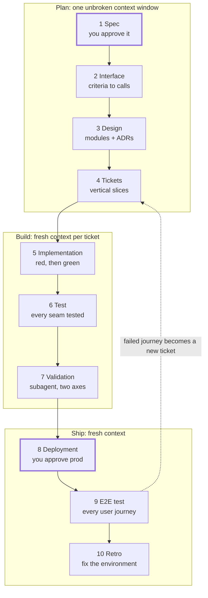

# Agent Skill Workflow for Software Development

Oct 16, 2026 · [Live doc](https://claude.ai/code/artifact/301ba23f-5dda-43bc-a355-98f36629db46) · [繁體中文版](dev-workflow-skills.zh-TW.md)

Ten user-invoked skills take a feature from spec to e2e test: plan in one context window, build each ticket fresh, then ship behind your approval.

## At a glance



Only two gates are yours (spec and production); every other stage ends on a criterion the agent checks itself.

## Principles carried over

The workflow applies the rules from [How to Build Your Own Agent Skill](how-to-build-agent-skill.md) to every stage of a normal software project, from spec to e2e test.

- **One stage, one skill, one artifact.** Each stage is a user-invoked skill that ends by writing a file (spec, interface, design, tickets, code, report). The next stage reads that file, not the chat history.
- **Two layers.** User-invoked skills orchestrate (`/to-spec`, `/deploy`). Model-invoked skills hold reusable discipline (`grilling`, `tdd`, `code-review`). Stages call disciplines, never other stages.
- **Context boundaries are deliberate.** Planning (spec to tickets) shares one unbroken context window. Each ticket gets a fresh window. Review always runs in a subagent. Deployment starts from a clean window that reads only the release notes.
- **Every stage ends on a checkable completion criterion.** "Every acceptance criterion maps to an interface call" instead of "interface designed".
- **Leading words per stage.** *Frontier* (spec), *deep module* (design), *vertical slice* (tickets), *red* (TDD), *two axes* (review), *rollback* (deploy), *user journey* (e2e).
- **Humans own the gates.** You approve the spec and the production deploy. Everything between is the agent's job to verify.

## The ten stages

Each stage is one user-invoked skill with one output artifact and one completion criterion; discipline skills it calls are in brackets.

| # | Stage | Skill (calls) | Context | Output artifact | Done when |
| --- | --- | --- | --- | --- | --- |
| 1 | Spec | `/grill-with-docs`, `/to-spec` (`grilling`, `domain-modeling`) | Plan window | `docs/specs/<feature>.md`, `GLOSSARY.md` | Frontier empty; every acceptance criterion is observable and testable; you approved it |
| 2 | Interface | `/to-interface` (`codebase-design`) | Plan window | Type signatures, API schema or proto; contract test stubs | Every acceptance criterion maps to at least one interface call; the stubs compile |
| 3 | Design | `/to-design` (`codebase-design`) | Plan window | `docs/design/<feature>.md`, ADRs in `docs/adr/` | Every interface call has an owning module, data flow and listed failure modes |
| 4 | Tickets | `/to-tickets` | Plan window | One ticket per vertical slice, with blocking edges | Every acceptance criterion is covered by a ticket; each ticket fits one context window |
| 5 | Implementation | `/implement` (`tdd`) | Fresh per ticket | Code + unit tests, one commit per ticket | The ticket's tests went red, then green; typecheck clean |
| 6 | Test | `/harden` (`tdd`) | Fresh | Integration and contract tests at the seams | Every acceptance criterion has a passing automated test; full suite green |
| 7 | Validation | `/validate` (`code-review`) | Subagent | Review report, two columns | Standards axis and spec axis both report; no blocking item open |
| 8 | Deployment | `/deploy` | Fresh | Release notes, deploy log, rollback command | Staging health checks green; rollback tested; you approved production |
| 9 | E2E test | `/e2e` | Fresh, against staging then prod | E2E report per user journey | Every user journey in the spec passes on the deployed environment |
| 10 | Retro | `/retro` | Same session as the work | Changes to skills, checks, standards | Each mistake became a check or a standard, or was dropped on purpose |

A failing stage loops back, never forward: a failed e2e journey becomes a new ticket (stage 4), and a spec-axis review finding goes back to implementation (stage 5), or to the spec (stage 1) if the spec itself was wrong.

## Skill files

The drafts below explain the idea behind each new stage. The installable, refined versions live in [`plugins/dev-flow/skills/`](../plugins/dev-flow/skills/). They are project-agnostic (commands come from `docs/dev-flow/config.md`) and self-contained, with their own `grilling`, `tdd`, `code-review` and `codebase-design`.

### `/to-interface` (stage 2)

```markdown
---
name: to-interface
description: Turn the approved spec into the public interface and contract test stubs.
disable-model-invocation: true
---

Read the spec named by the user. Call the Skill tool with "codebase-design".

1. List every acceptance criterion in the spec. Done when the list matches the spec one to one.
2. Write the smallest interface that satisfies all of them: types, function signatures, API schema or proto. Prefer a few deep calls to many shallow ones. Done when every criterion maps to at least one call.
3. Write a contract test stub per call, marked pending. Done when the stubs compile and the typecheck passes.
4. Append a mapping table (criterion → call → stub) to the spec.
```

### `/to-design` (stage 3)

```markdown
---
name: to-design
description: Design the modules behind the interface and record hard-to-reverse decisions.
disable-model-invocation: true
---

Read the spec and interface. Call the Skill tool with "codebase-design".

1. Assign each interface call to one owning module. Prefer deep modules with small interfaces. Done when no call is unowned.
2. For each module, write its data flow and its failure modes (timeouts, bad input, partial writes). Done when every module lists at least its inputs, outputs and failure modes.
3. Record an ADR in docs/adr/ for each decision that is hard to reverse, surprising without context, and a real trade-off.
4. Write docs/design/<feature>.md with the module map and a diagram.
```

### `/harden` (stage 6)

```markdown
---
name: harden
description: Fill the contract tests and add integration tests at every seam.
disable-model-invocation: true
---

Read the spec's criterion → call → stub table. Call the Skill tool with "tdd".

1. Turn every pending contract stub into a real test. Done when no stub is pending.
2. Add an integration test at each seam between modules in the design, using real dependencies where they start in under a few seconds. Done when every seam in the design has a test.
3. Run the full suite. Done when it is green and every acceptance criterion has at least one passing test.
```

### `/validate` (stage 7)

```markdown
---
name: validate
description: Two-axis review of the feature branch in a fresh subagent.
disable-model-invocation: true
---

Dispatch a subagent with the diff, the spec and the coding standards. In it, call the Skill tool with "code-review".

Report two columns side by side, never merged or re-ranked:
- Standards: each finding against the coding standards.
- Spec: each acceptance criterion as met, partly met or missing, with evidence.

Done when both columns are filled and every finding is marked blocking or not.
```

### `/deploy` (stage 8)

```markdown
---
name: deploy
description: Ship the validated branch to staging, then to production after approval.
disable-model-invocation: true
---

1. Write release notes from the spec and merged tickets. Done when every merged ticket appears.
2. Write the rollback command before deploying. Done when it is in the release notes.
3. Deploy to staging and run the health checks. Done when every health check is green.
4. Run the rollback on staging, then redeploy. Done when the rollback restored the previous version.
5. Ask the user to approve production. Deploy only after a yes.
6. Deploy to production and run the health checks. Done when every check is green, or the rollback has run.
```

### `/e2e` (stage 9)

```markdown
---
name: e2e
description: Run every user journey in the spec against a deployed environment.
disable-model-invocation: true
---

1. List every user journey in the spec. Done when each acceptance criterion a user can see belongs to a journey.
2. Write or update one e2e test per journey (Playwright, or the project's existing runner). Done when each journey has a test.
3. Run them against staging, then a smoke subset against production. Done when every journey passes on staging.
4. For each failure, write a ticket with the failing step, the expected result and the actual result.
```

### Router: `/dev-flow`

```markdown
---
name: dev-flow
description: Which stage skill to run next. A router over the dev workflow.
disable-model-invocation: true
---

The main flow is: /grill-with-docs → /to-spec → /to-interface → /to-design → /to-tickets (one context window), then /implement per ticket, /harden, /validate, /deploy, /e2e, /retro.

Before recommending a stage, read that stage's SKILL.md. Small change with no new interface: /grill-with-docs → /implement → /validate.
```

## Artifacts and gates

Stages hand off through files in the repo, so any stage can start from a fresh context and you can see every decision in git.

```
GLOSSARY.md                    # shared terms, written during stage 1
docs/
  specs/<feature>.md           # stage 1, + criterion → call → stub table from stage 2
  design/<feature>.md          # stage 3
  adr/NNNN-<decision>.md       # stage 3, only for hard-to-reverse decisions
  releases/<version>.md        # stage 8: release notes + rollback command
  reports/<feature>-review.md  # stage 7
  reports/<feature>-e2e.md     # stage 9
.scratch/<feature>/issues/     # stage 4 tickets (or your issue tracker)
src/  tests/  e2e/             # stages 2, 5, 6, 9
```

The gates between stages:

| Gate | Checked by | Passes when |
| --- | --- | --- |
| Spec approved | You | You confirm shared understanding and the acceptance criteria |
| Plan complete | Agent, end of stage 4 | Criterion → call → module → ticket is traceable for every criterion |
| Ticket done | Agent, stage 5 | Tests red then green, typecheck clean, committed |
| Feature valid | Subagent, stage 7 | No blocking finding on either axis |
| Production approved | You | Staging green and rollback tested |
| Released | Agent, stage 9 | Every user journey passes on production smoke |

The traceability chain in the second row is the backbone: each acceptance criterion should be followable from spec to interface call, module, ticket, test and e2e journey.

## Adopting it

Add stages one at a time, starting with the ones that fix failures you already see.

1. Install the packaged workflow: `/plugin marketplace add yennanliu/agent-workflow-test`, then `/plugin install dev-flow@agent-workflow`. It is self-contained, so Pocock's skills are optional. Commands are namespaced: `/dev-flow:spec`, `/dev-flow:implement`, and so on (see the [README](../README.md)).
2. Run `/dev-flow:setup` once per repo, and `/dev-flow:next` whenever you're unsure which stage comes next.
3. Run one real feature through the full flow. Read the reasoning traces and prune every line that didn't change behaviour.
4. After the feature, run `/retro` and turn repeated mistakes into checks (lint rules, CI steps) or coding standards.

Not every task needs ten stages:

| Task size | Stages to run |
| --- | --- |
| Bug fix or small change, no new interface | Grill → Implement → Validate (→ Deploy) |
| Feature inside one module | Spec → Tickets → Implement → Test → Validate → Deploy → E2E |
| New service, API or cross-team feature | All ten |

Keep stages 1 to 4 in one unbroken context window. If it approaches about 150k tokens before tickets are written, run `/handoff` at the nearest stage boundary and continue in a new session from the written artifacts.

Open questions to settle per project:

- Which runner the e2e stage uses (Playwright, Cypress, or an existing suite)
- Where tickets live (local `.scratch/` files or the issue tracker)
- What counts as a health check for `/deploy` in this project's environment
