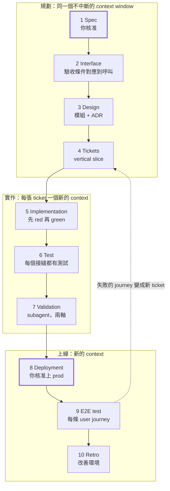

# 軟體開發的 Agent Skill 工作流程

2026 年 10 月 16 日 · [線上文件](https://claude.ai/code/artifact/301ba23f-5dda-43bc-a355-98f36629db46) · [English version](dev-workflow-skills.md)

十個 user-invoked skill 帶著一個功能從 spec 走到 e2e 測試：在同一個 context window 裡規劃，每張 ticket 在新的 context 裡實作，最後經過你的核准才上線。

## 全貌



只有兩道關卡由你把關（spec 和 production）；其他每個階段都結束在 agent 自己能檢查的完成標準上。

## 沿用的原則

這套流程把 [如何打造你自己的 Agent Skill](how-to-build-agent-skill.zh-TW.md) 的規則，套用到一般軟體專案從 spec 到 e2e 測試的每個階段。

- **一個階段、一個 skill、一份產出。** 每個階段是一個 user-invoked skill，結束時寫出一個檔案（spec、interface、design、tickets、程式碼、報告）。下一個階段讀那個檔案，而不是讀對話紀錄。
- **兩層分工。** user-invoked skill 負責編排（`/to-spec`、`/deploy`）；model-invoked skill 承載可重複使用的紀律（`grilling`、`tdd`、`code-review`）。階段只呼叫紀律層，不呼叫其他階段。
- **刻意安排 context 邊界。** 規劃（spec 到 tickets）共用一個不中斷的 context window；每張 ticket 開新的 window；review 一律跑 subagent；部署從乾淨的 window 開始，只讀 release notes。
- **每個階段都結束在可檢查的完成標準上。** 寫「每個驗收條件都對應到至少一個 interface 呼叫」，而不是「interface 設計完成」。
- **每個階段一個 leading word。** *frontier*（spec）、*deep module*（design）、*vertical slice*（tickets）、*red*（TDD）、*two axes*（review）、*rollback*（deploy）、*user journey*（e2e）。
- **關卡由人把關。** spec 和 production 部署由你核准；中間的一切由 agent 負責驗證。

## 十個階段

每個階段是一個 user-invoked skill，有一份產出和一個完成標準；括號內是它呼叫的紀律 skill。

| # | 階段 | Skill（呼叫） | Context | 產出 | 完成標準 |
| --- | --- | --- | --- | --- | --- |
| 1 | Spec | `/grill-with-docs`、`/to-spec`（`grilling`、`domain-modeling`） | 規劃 window | `docs/specs/<feature>.md`、`GLOSSARY.md` | frontier 清空；每個驗收條件都可觀察、可測試；你已核准 |
| 2 | Interface | `/to-interface`（`codebase-design`） | 規劃 window | 型別簽章、API schema 或 proto；contract test stub | 每個驗收條件都對應到至少一個 interface 呼叫；stub 可編譯 |
| 3 | Design | `/to-design`（`codebase-design`） | 規劃 window | `docs/design/<feature>.md`、`docs/adr/` 裡的 ADR | 每個 interface 呼叫都有負責的模組、資料流與列出的失敗模式 |
| 4 | Tickets | `/to-tickets` | 規劃 window | 每個 vertical slice 一張 ticket，含阻擋關係 | 每個驗收條件都被 ticket 涵蓋；每張 ticket 剛好一個 context window |
| 5 | Implementation | `/implement`（`tdd`） | 每張 ticket 新開 | 程式碼 + 單元測試，每張 ticket 一個 commit | ticket 的測試先 red 再 green；typecheck 通過 |
| 6 | Test | `/harden`（`tdd`） | 新開 | 接縫處的整合測試與 contract test | 每個驗收條件都有通過的自動化測試；整套測試全綠 |
| 7 | Validation | `/validate`（`code-review`） | Subagent | 兩欄的 review 報告 | 規範軸與需求軸都有結果；沒有未解決的阻擋項目 |
| 8 | Deployment | `/deploy` | 新開 | Release notes、部署紀錄、rollback 指令 | staging 健康檢查全綠；rollback 測過；你已核准上 production |
| 9 | E2E test | `/e2e` | 新開，先 staging 後 prod | 每條 user journey 的 e2e 報告 | spec 裡每條 user journey 在部署環境上都通過 |
| 10 | Retro | `/retro` | 與工作同一個 session | 對 skill、檢查、規範的改善 | 每個錯誤都變成檢查或規範，或被刻意放棄 |

失敗的階段只往回走，不往前跳：失敗的 e2e journey 變成新 ticket（階段 4）；需求軸的 review 發現回到實作（階段 5），如果是 spec 本身錯了，就回到 spec（階段 1）。

## Skill 檔案

以下新增的階段 skill 是草稿，複製到 `.claude/skills/<name>/SKILL.md` 後，再依實際執行結果修剪。階段 1、4、5、10 直接沿用 Pocock 的 skill（`grill-with-docs`、`to-spec`、`to-tickets`、`implement`、`retro`）。skill 內容保留英文，因為 agent 讀英文指示最穩定。

### `/to-interface`（階段 2）

```markdown
---
name: to-interface
description: Turn the approved spec into the public interface and contract test stubs.
disable-model-invocation: true
---

Read the spec named by the user. Call the Skill tool with "codebase-design".

1. List every acceptance criterion in the spec. Done when the list matches the spec one to one.
2. Write the smallest interface that satisfies all of them: types, function signatures, API schema or proto. Prefer a few deep calls to many shallow ones. Done when every criterion maps to at least one call.
3. Write a contract test stub per call, marked pending. Done when the stubs compile and the typecheck passes.
4. Append a mapping table (criterion → call → stub) to the spec.
```

### `/to-design`（階段 3）

```markdown
---
name: to-design
description: Design the modules behind the interface and record hard-to-reverse decisions.
disable-model-invocation: true
---

Read the spec and interface. Call the Skill tool with "codebase-design".

1. Assign each interface call to one owning module. Prefer deep modules with small interfaces. Done when no call is unowned.
2. For each module, write its data flow and its failure modes (timeouts, bad input, partial writes). Done when every module lists at least its inputs, outputs and failure modes.
3. Record an ADR in docs/adr/ for each decision that is hard to reverse, surprising without context, and a real trade-off.
4. Write docs/design/<feature>.md with the module map and a diagram.
```

### `/harden`（階段 6）

```markdown
---
name: harden
description: Fill the contract tests and add integration tests at every seam.
disable-model-invocation: true
---

Read the spec's criterion → call → stub table. Call the Skill tool with "tdd".

1. Turn every pending contract stub into a real test. Done when no stub is pending.
2. Add an integration test at each seam between modules in the design, using real dependencies where they start in under a few seconds. Done when every seam in the design has a test.
3. Run the full suite. Done when it is green and every acceptance criterion has at least one passing test.
```

### `/validate`（階段 7）

```markdown
---
name: validate
description: Two-axis review of the feature branch in a fresh subagent.
disable-model-invocation: true
---

Dispatch a subagent with the diff, the spec and the coding standards. In it, call the Skill tool with "code-review".

Report two columns side by side, never merged or re-ranked:
- Standards: each finding against the coding standards.
- Spec: each acceptance criterion as met, partly met or missing, with evidence.

Done when both columns are filled and every finding is marked blocking or not.
```

### `/deploy`（階段 8）

```markdown
---
name: deploy
description: Ship the validated branch to staging, then to production after approval.
disable-model-invocation: true
---

1. Write release notes from the spec and merged tickets. Done when every merged ticket appears.
2. Write the rollback command before deploying. Done when it is in the release notes.
3. Deploy to staging and run the health checks. Done when every health check is green.
4. Run the rollback on staging, then redeploy. Done when the rollback restored the previous version.
5. Ask the user to approve production. Deploy only after a yes.
6. Deploy to production and run the health checks. Done when every check is green, or the rollback has run.
```

### `/e2e`（階段 9）

```markdown
---
name: e2e
description: Run every user journey in the spec against a deployed environment.
disable-model-invocation: true
---

1. List every user journey in the spec. Done when each acceptance criterion a user can see belongs to a journey.
2. Write or update one e2e test per journey (Playwright, or the project's existing runner). Done when each journey has a test.
3. Run them against staging, then a smoke subset against production. Done when every journey passes on staging.
4. For each failure, write a ticket with the failing step, the expected result and the actual result.
```

### Router：`/dev-flow`

```markdown
---
name: dev-flow
description: Which stage skill to run next. A router over the dev workflow.
disable-model-invocation: true
---

The main flow is: /grill-with-docs → /to-spec → /to-interface → /to-design → /to-tickets (one context window), then /implement per ticket, /harden, /validate, /deploy, /e2e, /retro.

Before recommending a stage, read that stage's SKILL.md. Small change with no new interface: /grill-with-docs → /implement → /validate.
```

## 產出與關卡

階段之間透過 repo 裡的檔案交接，所以任何階段都能從新的 context 開始，每個決策也都留在 git 裡。

```
GLOSSARY.md                    # 共通詞彙，階段 1 寫入
docs/
  specs/<feature>.md           # 階段 1，加上階段 2 的 criterion → call → stub 對照表
  design/<feature>.md          # 階段 3
  adr/NNNN-<decision>.md       # 階段 3，只記難以反悔的決策
  releases/<version>.md        # 階段 8：release notes + rollback 指令
  reports/<feature>-review.md  # 階段 7
  reports/<feature>-e2e.md     # 階段 9
.scratch/<feature>/issues/     # 階段 4 的 tickets（或你的 issue tracker）
src/  tests/  e2e/             # 階段 2、5、6、9
```

階段之間的關卡：

| 關卡 | 由誰檢查 | 通過條件 |
| --- | --- | --- |
| Spec 核准 | 你 | 你確認達成共識，並同意驗收條件 |
| 規劃完成 | Agent，階段 4 結束時 | 每個驗收條件都能追蹤：criterion → call → module → ticket |
| Ticket 完成 | Agent，階段 5 | 測試先 red 再 green、typecheck 通過、已 commit |
| 功能有效 | Subagent，階段 7 | 兩軸都沒有阻擋項目 |
| Production 核准 | 你 | staging 全綠且 rollback 測過 |
| 已上線 | Agent，階段 9 | 每條 user journey 在 production smoke 測試通過 |

第二列的追蹤鏈是整套流程的骨幹：每個驗收條件都應該能從 spec 一路追到 interface 呼叫、模組、ticket、測試和 e2e journey。

## 如何導入

一次加一個階段，先從能修正你已經看到的問題的那幾個開始。

1. 安裝 Pocock 的 skill：`claude plugin install mattpocock-skills@claude-plugins-official`，接著每個 repo 跑一次 `/setup-matt-pocock-skills`。
2. 把上面的草稿 skill 複製到 `.claude/skills/`，並加上 `/dev-flow`，你只需要記得一個名字。
3. 拿一個真實功能完整跑一次流程。讀 reasoning trace，把沒有改變行為的每一行刪掉。
4. 功能完成後跑 `/retro`，把重複出現的錯誤變成檢查（lint 規則、CI 步驟）或程式碼規範。

不是每個任務都需要十個階段：

| 任務規模 | 要跑的階段 |
| --- | --- |
| 修 bug 或小改動，沒有新 interface | Grill → Implement → Validate（→ Deploy） |
| 單一模組內的功能 | Spec → Tickets → Implement → Test → Validate → Deploy → E2E |
| 新服務、新 API 或跨團隊功能 | 全部十個 |

階段 1 到 4 要在同一個不中斷的 context window 裡完成。如果寫 tickets 之前就接近約 150k tokens，在最近的階段交界處跑 `/handoff`，再從已寫好的產出檔案在新 session 繼續。

每個專案要各自決定的問題：

- e2e 階段用哪個 runner（Playwright、Cypress，或既有的測試套件）
- tickets 放在哪裡（本地 `.scratch/` 檔案或 issue tracker）
- 在這個專案的環境裡，`/deploy` 的健康檢查指的是什麼
