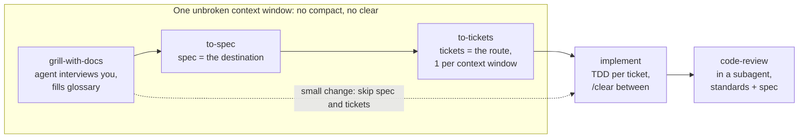

# How to Build Your Own Agent Skill

Oct 16, 2026 · [Live doc](https://claude.ai/code/artifact/7586a7b1-3d5b-4286-88bc-50563ddf4ed6) · [繁體中文版](how-to-build-agent-skill.zh-TW.md)

## 1. Why a skill exists

A skill exists to force determinism out of a random system. Matt Pocock calls today's situation "skill hell": skills are everywhere, but there is no shared standard for judging them or composing them.

"Predictable" means the agent follows the same *process* every time, not that it produces the same *output*. A brainstorming skill should diverge predictably: different tokens each run, same behaviour.

The design idea is to translate decades-old engineering discipline into a format agents can read, not to invent new process. Each core skill answers one classic failure:

| Agent failure | Old discipline | Skill that applies it |
| --- | --- | --- |
| Builds something you didn't want | Requirements interview | `grilling` / `grill-me`: the agent interviews you |
| Talks too much, terms drift | Ubiquitous language | `CONTEXT.md` shared glossary |
| Code doesn't work | TDD red-green loop | `tdd` |
| Code turns into a big ball of mud | Regular architecture review | architecture check every few days |

The glossary row shows the payoff. Without it you say "the lessons inside a course's sections break when they get made real". With it you say "the materialization cascade breaks".

## 2. Anatomy of a skill

A skill is a folder with a `SKILL.md`: YAML frontmatter on top, Markdown instructions below, and optional sibling files it points to.

```
.claude/skills/
  grilling/
    SKILL.md           # frontmatter + steps + core reference
  writing-for-agents/
    SKILL.md
    SKILL-MECHANICS.md # reference only some branches need
```

The frontmatter has three fields that matter:

| Field | Purpose |
| --- | --- |
| `name` | What you type (`/grill-me`) and what other skills call |
| `description` | For model-invoked skills: the trigger, always in context. For user-invoked: a one-line human summary |
| `disable-model-invocation: true` | Hides the skill from the agent; only you can fire it |

The body holds only two kinds of content:

- **Steps**: ordered actions, each ending on a completion criterion.
- **Reference**: definitions, rules and templates consulted on demand.

Each piece sits on one rung of a three-level information hierarchy:

1. In-file step (what the agent does, in order)
2. In-file reference (looked up while doing it)
3. Disclosed reference in a separate file, reached through a pointer

The whole design job is deciding which rung each line belongs on. Sections 3 to 6 are the four checks Pocock uses to make that call.

## 3. Check 1: Trigger (who invokes it)

Decide first who fires the skill, because that choice sets which budget you spend.

|  | Model-invoked | User-invoked |
| --- | --- | --- |
| Frontmatter | Keep a `description` | Add `disable-model-invocation: true` |
| Who can fire it | The agent, other skills, and you | Only you, by typing `/name` |
| Cost | **Context load**: the description sits in every turn | **Cognitive load**: you must remember it exists |
| Risk | The pointer may not be followed | You forget the skill |
| Role | Reusable **discipline layer** (`grilling`, `tdd`) | **Orchestration layer** (`grill-me`, `implement`) |

Pocock's key line: cognitive load is not a cost to minimise. It is the price of keeping the human in charge.

He prefers user-invoked. Every model-invoked skill adds a pointer that might not fire, so he removes that whole class of bug instead of tuning hit rates. With the full set installed (38 skills at the time of the talk), `/context` showed only about 660 tokens. His summary: "Superpowers gives the agent superpowers; my skills give *you* superpowers."

Rules that follow from the split:

- A user-invoked skill can call a model-invoked one. It cannot call another user-invoked one, since that skill has no description to reach.
- Reference shared by two user-invoked skills goes in a plain file outside the skill system that both point to.
- Once you can't remember your user-invoked skills, add one **router skill** that lists them and when to use each. His is `ask-matt`.
- Pick model-invoked only when the agent must reach the skill on its own, or another skill must.

## 4. Check 2: Structure (how content is laid out)

Split files by **branch**, not by length. A branch is one distinct way the skill gets used, so different runs take different paths through it.

- What every branch needs stays in `SKILL.md`.
- What only some branches need moves to a sibling file behind a pointer.
- Keep a concept's definition, rules and caveats under one heading (co-location), so reading one part brings its neighbours.

Example: `writing-for-agents` covers any agent-facing document. Only the "this is a skill" branch needs frontmatter rules, so those live in `SKILL-MECHANICS.md` with one pointer: *"When the document you're writing is a skill, read SKILL-MECHANICS.md."*

A pointer's wording, not its target, decides when and how reliably the agent reads the file. When a pointer is ignored, fix the wording first. Inline the material only if sharper wording fails.

A good pointer:

1. Front-loads the leading word.
2. Names one trigger per branch, with synonyms collapsed.
3. Drops identity the body already carries.

Push too little down and the top bloats. Push too much and you hide what the agent needs. That tension is the whole decision.

## 5. Check 3: Steering (making the agent comply)

Steer with leading words and completion criteria, and state what you want instead of what you forbid.

### Leading words

A leading word is a compact concept the model already knows from pretraining. Put it in the skill and the agent repeats it in its reasoning and output, and repeating it changes behaviour. Pocock calls this the single most important idea of his talk.

| Instead of a paragraph about... | Use the leading word |
| --- | --- |
| Building DB, then API, then UI layer by layer | *vertical slice* / *tracer bullets* |
| A fast, deterministic, low-overhead loop | *tight* loop |
| A test loop you trust to catch the bug | the loop goes *red* |
| Asking questions until nothing is assumed | *relentless* interview, *design tree*, *frontier* |

- **It's checkable.** Look in the reasoning trace: if the agent says the word back, the word is working.
- **It also drives triggering.** Write descriptions in the words you actually type in prompts.
- **Guard it from synonyms.** His `GLOSSARY.md` adds an *Avoid* line under each term listing synonyms not to use, so the meaning doesn't blur.
- Reach for an existing word before coining one. A made-up word recruits no priors, so you pay for its definition in tokens.

### Completion criteria

Every step ends on a criterion with two axes:

- **Clarity**: can the agent tell done from not done? A vague bound ("understanding reached") causes **premature completion**.
- **Demand**: how much work it requires. "Every modified model accounted for" forces more legwork than "produce a change list".

The strongest criteria are both checkable and exhaustive. `grilling` ends with: *"The session is done when the frontier is empty: every branch of the design tree visited, nothing left silently assumed."*

### Split only at a real context boundary

Plan mode fails in every implementation for the same reason. It has two steps, "ask clarifying questions" and "write the plan". The agent can see the finish line, so it rushes the questions. Pocock's fix is two skills, so the agent sees one step at a time (`grill-me`, then `to-spec`).

The order matters:

1. Sharpen the completion criterion first. It is local and cheap.
2. Split only if the criterion is irreducibly fuzzy *and* you observe the rush.
3. A split hides later steps only across a real boundary: a hand-off to you, a fresh session, or a subagent. An inline call in the same context hides nothing.

### Avoid negation

Prohibitions backfire because they put the forbidden behaviour into context. "Don't think of an elephant" makes the elephant the only thing present. Describe the target instead: "write one-line comments", not "don't write long comments". Keep a ban only as a hard guardrail you can't phrase positively, and pair it with the positive target.

## 6. Check 4: Pruning (cut until nothing more can go)

The bar is that every line must change the agent's behaviour, not that the skill must be short.

**The no-op test.** Lines like "write detailed commit messages", "be thorough" or "keep the code readable" change nothing, because the agent does that already. Delete the line and rerun. If the output doesn't change, the line was a no-op. Skills written by agents are especially full of them.

- No-ops are relative to the **model's default**, not to the reader. If two people argue about a line, they are arguing about the default. Settle it by running the skill.
- A weak leading word is itself a no-op. Fix it with a stronger word (*relentless* instead of *thorough*), not a different technique.
- When a sentence fails, delete the whole sentence rather than trimming words.

Three other things make skills long:

| Failure | What it is | Fix |
| --- | --- | --- |
| **Duplication** | The same meaning in two places, which inflates its rank on the hierarchy | One source of truth per meaning |
| **Sediment** | Layers added by many maintainers that nobody dares delete | Prune on a schedule; delete stale lines |
| **Sprawl** | Every line is live and unique, but the whole is too long | Disclose reference behind pointers; split by branch or sequence |

Duplication is the accidental opposite of a leading word: a leading word repeats a *token* on purpose, duplication repeats a *meaning* by accident.

Also treat the environment as a source of truth. Leave `package.json` scripts, config and `--help` output to the agent to look up. Write down only what it can't find by looking: unwritten conventions, the reason behind a choice, and gotchas.

**How small is small?** `grill-me` is a single line, *"Call the Skill tool with grilling."* (about 20 words with frontmatter). `implement` is about 70 words and `grilling` about 136 words in the talk version. `wayfinder` runs past 2,000 words, which is fine because every line earns its place.

## 7. Worked example: the grilling family

The pattern to copy is a thin user-invoked wrapper over a reusable model-invoked primitive. Below are the real files from the repo (MIT licence).

### The wrapper: `grill-me/SKILL.md` (user-invoked)

```markdown
---
name: grill-me
description: A relentless interview to sharpen a plan or design.
disable-model-invocation: true
---

Call the Skill tool with "grilling".
```

### The primitive: `grilling/SKILL.md` (model-invoked)

```markdown
---
name: grilling
description: Grill the user relentlessly about a plan, decision, or idea. Use when the user wants to stress-test their thinking, or uses any 'grill' trigger phrases.
---

Interview the user relentlessly until you reach a shared understanding. Map this as a **design tree**: every decision branches into the decisions that hang off it.

Work the tree in **rounds**. The **frontier** is every decision whose prerequisites are already settled. Ask the whole frontier in one round: number each question and give your recommended answer. Then wait for the user's answers before the next round.

Word each question so "yes" accepts your recommended answer.

Finding _facts_ is your job, never the user's. When a frontier question needs a fact from the environment, dispatch a sub-agent to find it. The _decisions_ are the user's: put each to them and wait.

The session is done when the frontier is empty: every branch of the design tree visited, nothing left silently assumed. Do not act on it until the user confirms you have reached a shared understanding.
```

(Shortened; the original also defines the round's output format.)

What each of the four checks did here:

- **Trigger**: the wrapper is user-invoked and costs zero context. The primitive is model-invoked so other skills can reuse it.
- **Structure**: all steps, no disclosed files. Every branch needs every line.
- **Steering**: leading words *relentless*, *design tree*, *rounds*, *frontier*; a checkable end ("frontier is empty").
- **Pruning**: about 300 words, with no "be thorough" or "ask good questions".

### Stateful variant: `grill-with-docs`

`grill-with-docs` is also a single line: *"Call the Skill tool twice, for grilling and domain-modeling."* It runs the same interview inside a repo and writes as it goes:

- Reads the code to answer anything the codebase can answer, instead of asking you.
- Writes each agreed term into the glossary immediately, not batched at the end.
- Records an ADR in `docs/adr/` only when a decision is hard to reverse, surprising without context, and a real trade-off. Most sessions produce none.

The glossary was called `CONTEXT.md` in the talk; the current repo names it `GLOSSARY.md`. An illustrative entry (not copied from the repo):

```markdown
## Materialization cascade
When a lesson in a course section is turned into a real, published page, and the change propagates to its parent section and course.
Avoid: publish chain, sync, rollout
```

## 8. Composing skills into a workflow

Pocock's main flow chains five user-invoked skills, and the context boundaries between them do as much work as the skills themselves.



The first three steps share one context window, so the spec and tickets build on the same thinking as the interview. Each ticket is then implemented in a fresh window. To change direction, edit the spec and delete unstarted tickets; never rewrite the whole plan.

- **Context limit.** The talk put the limit around 120k tokens; the repo's router now says about 150k (the "smart zone"). Near the limit, start a new conversation at a phase boundary.
- **Spec vs tickets.** The spec is the destination, tickets are the route. Each ticket fits exactly one context window.
- **Review in a subagent.** The agent that just wrote the code thinks it is good, so it can neither fix nor judge it.
- **Two review axes, never merged.** One checks standards, one checks the spec, shown side by side and not re-ranked. Merging lets "meets every convention but builds the wrong thing" hide behind "builds the right thing but breaks conventions", and the reverse.
- **Raise effort from low to high.** High effort pays off on benchmarks but wastes tokens on daily work, and more tokens means faster attention decay.
- **Router.** `ask-matt` lists this flow and its branches, so you only have to remember one skill.

## 9. Build your first skill: step by step

Start from one recurring failure you see in your own agent sessions, not from a skill you'd like to have.

1. **Name the failure.** Write one sentence: "The agent keeps \_\_\_." Done when you can point to two or more real sessions where it happened.
2. **Find the old discipline.** Which engineering practice already solves this (interviews, TDD, glossary, code review, ADRs)? Done when you have its name.
3. **Pick the leading word.** Choose the pretrained term the agent should think with (*vertical slice*, *red*, *frontier*). Done when one word or phrase stands for the whole behaviour.
4. **Choose the trigger.** Default to user-invoked. Make it model-invoked only if the agent or another skill must reach it. Done when frontmatter says which.
5. **Write the steps.** One action per step, each ending on a checkable, exhaustive completion criterion. Done when every step has a done condition.
6. **Place the reference.** Inline what every branch needs; move branch-only material to a sibling file with a sharply worded pointer.
7. **Run it.** Use the skill on a real task and read the reasoning trace. Done when the agent repeats your leading word and follows every step.
8. **Prune.** Delete each suspect line and rerun. Keep only lines whose removal changes the output.
9. **Split only if needed.** If the agent rushes a step because it can see the finish, sharpen that step's criterion. Still rushing? Split at a real context boundary.

### Starter template

```markdown
---
name: <verb-or-noun-you-actually-type>
description: <one line, in the words you use in prompts>
disable-model-invocation: true   # delete this line to make it model-invoked
---

<Goal in one sentence, using the leading word.>

1. <Action>. Done when <checkable, exhaustive condition>.
2. <Action>. Done when <condition>.

When <branch condition>, read [REFERENCE.md](REFERENCE.md).
```

### Review checklist

- [ ] Trigger: invocation choice is deliberate; a model-invoked description uses words I really type
- [ ] Trigger: no user-invoked skill calls another user-invoked skill
- [ ] Structure: every in-file line is needed by every branch
- [ ] Structure: each pointer names its trigger condition clearly
- [ ] Steering: one leading word per behaviour, visible in the reasoning trace
- [ ] Steering: every step ends on a checkable completion criterion
- [ ] Steering: rules are phrased as the target behaviour, not as bans
- [ ] Pruning: each line passed the delete-and-rerun no-op test
- [ ] Pruning: no meaning appears in two places
- [ ] Pruning: nothing restates what the agent can look up in the repo

## 10. Pocock vs mainstream guidance

Before choosing whose advice to follow, decide what kind of skill you are writing.

| Topic | Mainstream (Anthropic best practices, Perplexity) | Pocock |
| --- | --- | --- |
| Triggering | Teach the model to pick the right skill | Turn model triggering off: 13 of 22 core skills disabled |
| When to split files | By length (official guidance: under 500 lines) | By branch |
| Over time | Mostly accumulate (Perplexity: skills only grow) | Pruning is one of the four checks |

The third row is the only direct contradiction, and it comes from context:

- **Product skills** (Perplexity's case) run inside a product for the model, are backed by evals, and are read only by engineers. Accumulating is safe there.
- **Personal workflow skills** (Pocock's case) are typed by you every day, so you must be able to read and remember them. Pruning matters there.

For a team at Junyi building skills for its own engineers' daily workflow, Pocock's approach is the closer fit. For skills inside a learner-facing product, lean on evals and mainstream guidance.

## Sources

- [Matt Pocock skill design philosophy (aihao blog, Chinese)](https://blog.aihao.tw/2026/07/25/mattpocock-skills-design-philosophy)
- [mattpocock/skills on GitHub](https://github.com/mattpocock/skills), including [`writing-for-agents`](https://github.com/mattpocock/skills/tree/main/skills/productivity/writing-for-agents) and [`ask-matt`](https://github.com/mattpocock/skills/tree/main/skills/engineering/ask-matt)
- [grill-with-docs on AI Hero](https://www.aihero.dev/grill-with-docs)

Install the full set in Claude Code with `claude plugin install mattpocock-skills@claude-plugins-official`, then run `/setup-matt-pocock-skills` once per repo.
