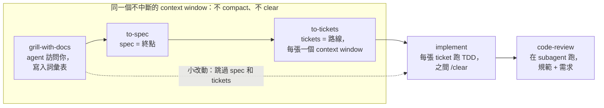

# 如何打造你自己的 Agent Skill

2026 年 10 月 16 日 · [線上文件（英文版）](https://claude.ai/code/artifact/7586a7b1-3d5b-4286-88bc-50563ddf4ed6) · [English version](how-to-build-agent-skill.md)

## 1. Skill 為什麼存在

Skill 存在的目的，是從一個隨機的系統裡硬是逼出確定性。Matt Pocock 把現在的處境叫做 skill hell：skill 到處都是，但沒有一套判斷好壞、決定怎麼組合的共用標準。

「可預測」指的是 agent 每次走同樣的*流程*，不是每次產出同樣的*結果*。brainstorming skill 應該「可預測地發散」：每次 token 都不同，但行為不變。

他的設計思路不是發明新流程，而是把驗證了幾十年的工程紀律，翻譯成 agent 讀得懂的格式。每個核心 skill 對應一個老問題：

| Agent 的問題 | 對應的工程紀律 | 套用它的 skill |
| --- | --- | --- |
| 做出來的不是我要的 | 需求訪談 | `grilling` / `grill-me`：agent 反過來訪問你 |
| 講話太囉嗦、用詞飄移 | 共通語言（ubiquitous language） | `CONTEXT.md` 共通詞彙表 |
| 程式不能動 | TDD red-green 迴圈 | `tdd` |
| 做出一個大泥球 | 定期架構檢查 | 每隔幾天跑一次架構檢查 |

詞彙表那一列最能看出效果。沒有詞彙表，你要說「course 的 section 裡的 lesson 被『變成真的』的時候會出問題」；有了它，只要說「materialization cascade 會出問題」。

## 2. Skill 的結構

一個 skill 就是一個含有 `SKILL.md` 的資料夾：上面是 YAML frontmatter，下面是 Markdown 指示，旁邊可以放它會指向的其他檔案。

```
.claude/skills/
  grilling/
    SKILL.md           # frontmatter + 步驟 + 核心 reference
  writing-for-agents/
    SKILL.md
    SKILL-MECHANICS.md # 只有部分 branch 會用到的 reference
```

frontmatter 裡重要的欄位有三個：

| 欄位 | 用途 |
| --- | --- |
| `name` | 你輸入的指令（`/grill-me`），也是其他 skill 呼叫它的名字 |
| `description` | model-invoked：觸發條件，永遠在 context 裡。user-invoked：給人看的一行摘要 |
| `disable-model-invocation: true` | 對 agent 隱藏這個 skill，只有你能叫起來 |

本體只由兩種內容組成：

- **Steps（步驟）**：照順序做的動作，每一步結束在一個完成標準上。
- **Reference（參考）**：隨時查閱的定義、規則、範本。

每一段內容都放在三層資訊階層的其中一層：

1. SKILL.md 裡的 step（agent 依序要做的事）
2. SKILL.md 裡的 reference（做事時查閱）
3. 推到外部檔案的 reference，透過 pointer 指過去

整個設計工作，就是決定每一行該放在哪一層。第 3 到 6 節是 Pocock 用來做這個判斷的四項檢查。

## 3. 檢查一：Trigger（誰來叫起它）

先決定誰觸發這個 skill，因為這個選擇決定你花的是哪一種成本。

|  | Model-invoked | User-invoked |
| --- | --- | --- |
| Frontmatter | 保留 `description` | 加上 `disable-model-invocation: true` |
| 誰能觸發 | agent、其他 skill、你 | 只有你，輸入 `/name` |
| 成本 | **Context load**：description 每一輪都在 context 裡 | **Cognitive load**：你得記得它存在 |
| 風險 | pointer 可能不被跟隨 | 你忘了有這個 skill |
| 角色 | 可重複使用的**紀律層**（`grilling`、`tdd`） | **編排層**（`grill-me`、`implement`） |

他最關鍵的一句話：cognitive load 不是要最小化的成本，而是人保有主導權的代價。

他偏好 user-invoked。每多一個 model-invoked skill，就多一個可能不被跟隨的 pointer；與其提高命中率，他寧可讓這整類問題不存在。全部裝上（演講當時 38 個 skill），`/context` 只佔約 660 tokens。他的總結是：「Superpowers 是給 agent 超能力，我的 skills 是給*你*超能力。」

由此延伸的規則：

- user-invoked 可以呼叫 model-invoked，但不能呼叫另一個 user-invoked，因為對方沒有 description 可以被找到。
- 兩個 user-invoked skill 都需要的 reference，放在 skill 系統外的一般檔案，讓兩者都指過去。
- user-invoked skill 多到記不住時，加一個 **router skill**，列出所有 skill 和各自的使用時機。他的 router 是 `ask-matt`。
- 只有當 agent 必須自己找到它，或其他 skill 必須呼叫它時，才選 model-invoked。

## 4. 檢查二：Structure（內容怎麼排）

依 **branch** 拆檔，不是依長度。branch 是 skill 的一種用法，不同的執行會走不同的路徑。

- 每條 branch 都會用到的，留在 `SKILL.md`。
- 只有部分 branch 用到的，推到旁邊的檔案，用 pointer 指過去。
- 同一個概念的定義、規則、注意事項放在同一個標題下（co-location），讀到一部分就會連帶讀到相關內容。

例子：`writing-for-agents` 涵蓋所有給 agent 讀的文件。只有「這份文件是 skill」這條 branch 需要 frontmatter 規則，所以那部分放在 `SKILL-MECHANICS.md`，只用一個 pointer：*「如果你正在寫的文件是 skill，請讀 SKILL-MECHANICS.md。」*

決定 agent 什麼時候去讀、讀得多可靠的，是 pointer 的措辭，不是它指向什麼。pointer 沒被跟隨時，先修措辭；措辭改了還是沒用，才把內容搬回本體。

好的 pointer：

1. 把 leading word 放在最前面。
2. 每條 branch 只寫一個觸發條件，同義詞合併。
3. 不重複本體已經說過的身分描述。

往下推太少，上層會臃腫；推太多，agent 需要的東西會被藏起來。這個拉扯就是整個判斷。

## 5. 檢查三：Steering（怎麼讓它照做）

用 leading word 和完成標準來引導，並且描述你要的行為，而不是你禁止的行為。

### Leading word

leading word 是一個已經存在於模型預訓練裡的壓縮概念。把它放進 skill，agent 會在思考過程和輸出裡複述這個詞，複述的同時就改變了行為。Pocock 說這是整場演講最想給的一件事。

| 與其寫一長段解釋… | 不如用這個 leading word |
| --- | --- |
| 先寫完資料庫層、再寫 API、最後才寫前端 | *vertical slice（垂直切片）* / *tracer bullets* |
| 快速、確定、低成本的迴圈 | *tight* loop |
| 一個你相信能抓到 bug 的測試迴圈 | 迴圈變 *red* |
| 一直問到沒有任何假設為止 | *relentless* 訪談、*design tree*、*frontier* |

- **它可以被驗證。** 去 reasoning trace 裡看 agent 有沒有把這個詞說回來，有就代表有效。
- **它也作用在觸發上。** description 要用你在 prompt 裡真的會講的詞來寫。
- **防止同義詞稀釋。** 他的 `GLOSSARY.md` 在每個術語底下附一行 *Avoid*，列出不該用的同義詞，避免意思被換來換去而變模糊。
- 先找現成的詞，再考慮自創。自創的詞喚不起任何先驗，你得花 token 去定義它。

### 完成標準

每一步都結束在一個完成標準上，它有兩個軸：

- **清晰度**：agent 分得出做完和沒做完嗎？模糊的標準（「達成理解」）會導致 **premature completion（過早完成）**。
- **要求強度**：決定 agent 願意做多少前置工作。「每一個被修改的 model 都有交代」比「產出一份變更清單」逼出更多功夫。

最強的標準既可檢查、又要求窮盡。`grilling` 的結尾是：*「當 frontier 清空時 session 才算結束：design tree 的每條 branch 都走過，沒有任何東西被默默假設。」*

### 只在真正的 context 邊界拆分

plan mode 不管哪種實作都有同一個問題。它有「問澄清問題」和「產出計畫」兩步，agent 看得到終點是產出計畫，所以問問題那步永遠敷衍。Pocock 的解法是拆成兩個 skill，讓 agent 一次只看到一步（先 `grill-me`，再 `to-spec`）。

順序很重要：

1. 先把完成標準寫明確。這是局部且便宜的修法。
2. 只有當標準本質上就模糊、*而且*你真的觀察到 agent 在趕，才拆分。
3. 拆分只有跨越真正的邊界才藏得住後續步驟：交給人手動接續、開新對話、或丟給 subagent。在同一個 context 裡 inline 呼叫，什麼都沒藏到。

### 避免 negation（禁令）

用禁令引導會有反效果，因為禁令把被禁止的行為帶進了 context。「不要想大象」講完，大象就是唯一在場的東西。改成正面描述目標行為：寫「註解只寫一行」，而不是「不要寫很長的註解」。只有在無法用正面方式表達的硬性護欄才保留禁令，而且要搭配正面的目標行為。

## 6. 檢查四：Pruning（刪到不能再刪）

標準不是「一律要短」，而是「每一行都得改變 agent 的行為」。

**No-op 測試。** 「commit message 要寫得很詳細」「要徹底」「實作要好讀」這類句子對 agent 的行為毫無影響，因為它本來就會這樣做。刪掉那一行再跑一次，輸出沒變，那行就是 no-op。agent 自己寫的 skill 尤其滿是 no-op。

- no-op 是相對於**模型的預設行為**，不是相對於讀者。兩個人爭論某一行是不是 no-op，其實是在爭論模型的預設行為長什麼樣，該用跑一次來解決，不是用辯的。
- 太弱的 leading word 本身就是 no-op。修法是換一個更強的詞（用 *relentless* 取代 *thorough*），不是換一種技巧。
- 一句話沒通過測試，就整句刪掉，不要只修剪幾個字。

另外三種讓 skill 變長的原因：

| 問題 | 是什麼 | 修法 |
| --- | --- | --- |
| **Duplication（重複）** | 同一個意思出現在兩處，不當抬高它在資訊階層上的位階 | 每個意思只有一個 source of truth |
| **Sediment（沉積）** | 多人共同維護，每個人都往裡面加，沒人敢刪別人寫的 | 定期修剪，刪掉過時的內容 |
| **Sprawl（蔓延）** | 每一行都有效、都不重複，但整份就是太長 | 把 reference 推到 pointer 後面；依 branch 或順序拆分 |

duplication 剛好是 leading word 的反面：leading word 是刻意重複同一個*詞*，duplication 是不小心重複了同一個*意思*。

環境本身也是 source of truth。`package.json` scripts、設定檔、`--help` 輸出，讓 agent 自己去查。只寫下它查不到的東西：沒寫出來的慣例、某個選擇背後的理由、各種陷阱。

**到底多小？** `grill-me` 只有一行 *「Call the Skill tool with grilling.」*（含 frontmatter 約 20 個英文字）。`implement` 約 70 字，演講版本的 `grilling` 約 136 字。`wayfinder` 超過兩千字也沒問題，因為每一行都有存在的理由。

## 7. 實例：grilling 家族

值得照抄的模式是：一個很薄的 user-invoked 外殼，包住一個可重複使用的 model-invoked 基礎 skill。以下是 repo 裡的真實檔案（MIT 授權），保留英文原文。

### 外殼：`grill-me/SKILL.md`（user-invoked）

```markdown
---
name: grill-me
description: A relentless interview to sharpen a plan or design.
disable-model-invocation: true
---

Call the Skill tool with "grilling".
```

### 基礎 skill：`grilling/SKILL.md`（model-invoked）

```markdown
---
name: grilling
description: Grill the user relentlessly about a plan, decision, or idea. Use when the user wants to stress-test their thinking, or uses any 'grill' trigger phrases.
---

Interview the user relentlessly until you reach a shared understanding. Map this as a **design tree**: every decision branches into the decisions that hang off it.

Work the tree in **rounds**. The **frontier** is every decision whose prerequisites are already settled. Ask the whole frontier in one round: number each question and give your recommended answer. Then wait for the user's answers before the next round.

Word each question so "yes" accepts your recommended answer.

Finding _facts_ is your job, never the user's. When a frontier question needs a fact from the environment, dispatch a sub-agent to find it. The _decisions_ are the user's: put each to them and wait.

The session is done when the frontier is empty: every branch of the design tree visited, nothing left silently assumed. Do not act on it until the user confirms you have reached a shared understanding.
```

（已節錄；原檔還定義了每一輪的輸出格式。）

四項檢查在這裡各自做了什麼：

- **Trigger**：外殼是 user-invoked，context 成本為零。基礎 skill 是 model-invoked，讓其他 skill 可以重複使用。
- **Structure**：全部是步驟，沒有外部檔案。每條 branch 都需要每一行。
- **Steering**：leading word 有 *relentless*、*design tree*、*rounds*、*frontier*；結尾有可檢查的完成標準（「frontier 清空」）。
- **Pruning**：約 300 字，沒有「要徹底」或「問好問題」這類句子。

### 有狀態的版本：`grill-with-docs`

`grill-with-docs` 也只有一行：*「Call the Skill tool twice, for grilling and domain-modeling.」* 它在 repo 裡跑同樣的訪談，邊問邊寫：

- 程式碼能回答的問題，先讀程式碼，不問你。
- 每個達成共識的術語，立刻寫進詞彙表，不是最後才一次寫。
- 只有當決策難以反悔、沒有背景會讓人意外、而且是真正的取捨時，才在 `docs/adr/` 記一筆 ADR。多數 session 一筆都不會產生。

詞彙表在演講中叫 `CONTEXT.md`，目前 repo 改名為 `GLOSSARY.md`。以下是示意條目（非 repo 原文）：

```markdown
## Materialization cascade
當 course section 裡的 lesson 被轉成真正發布的頁面，且這個變更連帶傳遞到上層的 section 與 course。
Avoid: publish chain, sync, rollout
```

## 8. 把 skill 組成工作流程

Pocock 的主流程串起五個 user-invoked skill，而它們之間的 context 邊界，和 skill 本身一樣重要。



前三步共用同一個 context window，所以 spec 和 tickets 都建立在同一次訪談的思考上。之後每張 ticket 各自在新的 window 裡實作。要改方向時，只改 spec、刪掉還沒做的 tickets，不用重寫整份計畫。

- **Context 上限。** 演講說約 120k tokens；repo 的 router 現在寫約 150k（所謂 smart zone）。快到上限時，在階段交界處開新對話。
- **Spec 與 tickets。** spec 是終點，tickets 是路線。每張 ticket 剛好一個 context window。
- **Review 一定跑 subagent。** 主 agent 剛把程式寫出來，會覺得自己寫得很好，改不動也審不動。
- **Review 分兩軸，不合併。** 一軸看規範、一軸看需求，並排呈現，不重新排名。「完全符合規範但做錯東西」和「做對東西但違反慣例」都很常見，合併會讓一軸遮住另一軸。
- **Effort 從低往高調。** 高 effort 在 benchmark 上划算，但日常任務只是浪費，而且 token 耗越多注意力衰退越快。
- **Router。** `ask-matt` 列出這個流程與各個分支，你只需要記得一個 skill。

## 9. 打造你的第一個 skill：逐步指南

從你自己 agent session 裡反覆出現的一個問題開始，而不是從一個「想要有」的 skill 開始。

1. **說出問題。** 寫一句話：「agent 老是＿＿＿。」完成標準：能指出至少兩次真實發生的 session。
2. **找出對應的工程紀律。** 哪個既有的工程實踐已經解決這個問題（訪談、TDD、詞彙表、code review、ADR）？完成標準：叫得出它的名字。
3. **選 leading word。** 選一個 agent 該拿來思考的預訓練術語（*vertical slice*、*red*、*frontier*）。完成標準：一個詞或短語就能代表整個行為。
4. **決定 trigger。** 預設 user-invoked。只有 agent 或其他 skill 必須找到它時，才改成 model-invoked。完成標準：frontmatter 寫清楚是哪一種。
5. **寫步驟。** 每步一個動作，每步結束在可檢查、要求窮盡的完成標準上。完成標準：每一步都有「做完」的條件。
6. **擺放 reference。** 每條 branch 都需要的放本體；只有部分 branch 需要的推到旁邊的檔案，配上措辭明確的 pointer。
7. **實際跑一次。** 用在真實任務上，讀 reasoning trace。完成標準：agent 複述了你的 leading word，並且走完每一步。
8. **修剪。** 把可疑的每一行刪掉再跑一次，只保留刪掉後輸出會改變的那幾行。
9. **必要時才拆分。** 如果 agent 因為看得到終點而趕某一步，先把那步的完成標準寫明確。還是在趕？才在真正的 context 邊界拆分。

### 起手範本

```markdown
---
name: <你真的會輸入的動詞或名詞>
description: <一行，用你在 prompt 裡會講的詞>
disable-model-invocation: true   # 刪掉這行就變成 model-invoked
---

<用一句話說明目標，並使用 leading word。>

1. <動作>。完成標準：<可檢查、要求窮盡的條件>。
2. <動作>。完成標準：<條件>。

當 <branch 條件> 時，請讀 [REFERENCE.md](REFERENCE.md)。
```

### 檢查清單

- [ ] Trigger：invocation 是刻意選擇的；model-invoked 的 description 用的是我真的會打的詞
- [ ] Trigger：沒有 user-invoked skill 去呼叫另一個 user-invoked skill
- [ ] Structure：本體裡的每一行，每條 branch 都需要
- [ ] Structure：每個 pointer 都清楚寫出觸發條件
- [ ] Steering：每個行為一個 leading word，而且在 reasoning trace 裡看得到
- [ ] Steering：每一步都結束在可檢查的完成標準上
- [ ] Steering：規則以目標行為表達，不是禁令
- [ ] Pruning：每一行都通過「刪掉再跑」的 no-op 測試
- [ ] Pruning：沒有任何意思出現在兩個地方
- [ ] Pruning：沒有重述 agent 在 repo 裡查得到的東西

## 10. Pocock 與主流做法的差異

在決定要照誰的建議之前，先想清楚你寫的是哪一種 skill。

| 面向 | 主流（Anthropic 官方 best practices、Perplexity） | Pocock |
| --- | --- | --- |
| 觸發 | 教模型選對 skill | 直接關掉模型觸發：22 個核心 skill 有 13 個關掉 |
| 何時拆檔 | 依長度（官方建議 500 行以內） | 依 branch |
| 長期維護 | 傾向持續累加（Perplexity：skill 基本上只增不減） | 「刪」是四項檢查之一 |

第三列是唯一兩邊建議完全相反的地方，差別來自使用情境：

- **產品型 skill**（Perplexity 的情境）跑在自家產品裡給模型用、有 eval 撐著、只有工程師會讀。累加在那裡是安全的。
- **個人工作流程 skill**（Pocock 的情境）是你每天親手打指令叫起來的，你也得讀得懂、記得住。修剪在這裡很重要。

如果是 Junyi 團隊為自家工程師的日常工作流程打造 skill，Pocock 的做法比較貼近。如果是放進面向學習者的產品裡的 skill，就以 eval 和主流做法為主。

## 參考資料

- [Matt Pocock 的 skill 設計哲學（aihao 部落格）](https://blog.aihao.tw/2026/07/25/mattpocock-skills-design-philosophy)
- [GitHub 上的 mattpocock/skills](https://github.com/mattpocock/skills)，包含 [`writing-for-agents`](https://github.com/mattpocock/skills/tree/main/skills/productivity/writing-for-agents) 與 [`ask-matt`](https://github.com/mattpocock/skills/tree/main/skills/engineering/ask-matt)
- [AI Hero 上的 grill-with-docs](https://www.aihero.dev/grill-with-docs)

在 Claude Code 安裝整套：`claude plugin install mattpocock-skills@claude-plugins-official`，接著每個 repo 跑一次 `/setup-matt-pocock-skills`。
