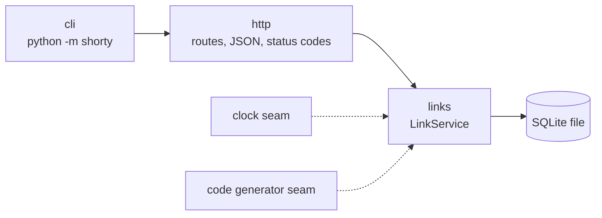

# Design: url-shortener

`links` is the deep module: one small class hides validation, code generation, idempotency and storage. `http` only translates between HTTP and `LinkService` calls.

## links (`src/shorty/links.py`)
- **Inputs:** a target URL (`shorten`), a code (`follow`, `stats`).
- **Outputs:** a `Link` (code, url, created_at, hits); `shorten` also says whether it created the link.
- **Data flow:** validate URL (no spaces or control characters, ASCII host, non-ASCII path/query percent-encoded) → look up by URL (unique index) → if absent, insert with a new code, retrying on code collision → return. `follow` increments `hits` and reads the row in one transaction.
- **Failure modes:** bad URL → `InvalidURL`; unknown code → `LinkNotFound`; 5 code collisions in a row → `RuntimeError`; two threads shortening the same URL at once → the unique index makes the loser read the winner's row; concurrent follows → serialised by SQLite's write lock, so no hit is lost.

## http (`src/shorty/http.py`)
- **Inputs:** HTTP requests on `ThreadingHTTPServer`.
- **Outputs:** JSON bodies, `302` redirects.
- **Data flow:** route by method and path → call `LinkService` → map `InvalidURL` to 400, `LinkNotFound` to 404, anything else to 500, always as `{"error": ...}`.
- **Failure modes:** non-JSON, oversized (over 8 KiB) or negative-length body → 400; unknown route → 404; unsupported method → 501; malformed request line → 400; unexpected exception → 500 with the trace logged. Every error, including the stdlib's own, is JSON. Idle sockets time out after 10 s.

## cli (`src/shorty/__main__.py`)
- **Inputs:** `--host`, `--port`, `--db`, `--base-url`.
- **Outputs:** a running server; exits cleanly on SIGINT/SIGTERM.
- **Data flow:** parse flags → open `LinkService(db)` → `make_server` → `serve_forever`.
- **Failure modes:** port in use or unwritable db path → exits non-zero with the error on stderr.

Requires SQLite 3.35+ (for `UPDATE … RETURNING`), bundled with Python 3.10+ on most platforms.

## Seams
- **SQLite:** real in every test (a temp file opens in milliseconds), so there is no fake.
- **Clock and code generator:** constructor arguments on `LinkService`, so tests can force a code collision.

Decision record: [ADR 0001, random codes](../../adr/0001-random-codes.md).
